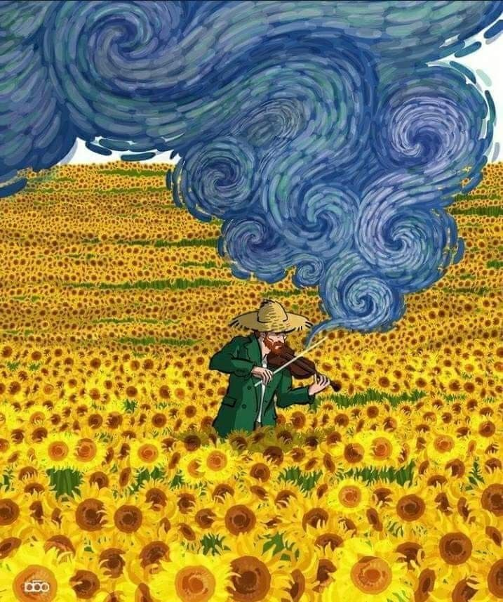

Illustration by <artist name / link here> — not my work, shown with credit

# 🌻 Hi, I'm vangogh-git

*Painting with code, one commit at a time.*

---

### 🎨 About me
- 🌙 Currently working on: **<your project here>**
- 🌱 Currently learning: **<your tech here>**
- 💬 Ask me about: **<your skills here>**
- ⚡ Fun fact: **<something about you>**

### 🖌️ My palette (tech stack)

### 📊 GitHub stats

### 📫 Reach me
<!-- Replace with your own links -->

🌻 *"The more I think about it, the more I realise there is nothing more artistic than to love others."* 🌻

